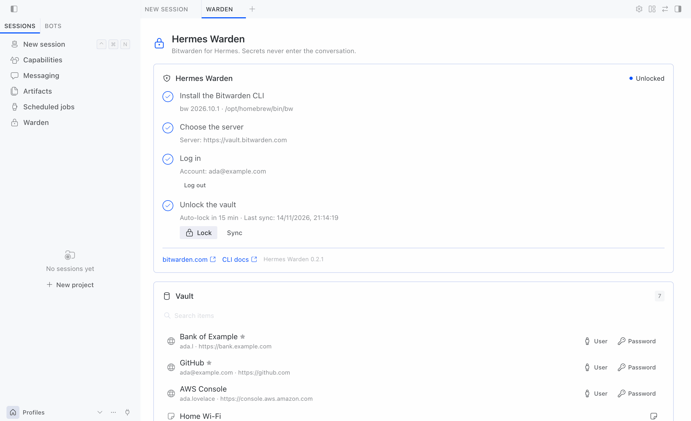
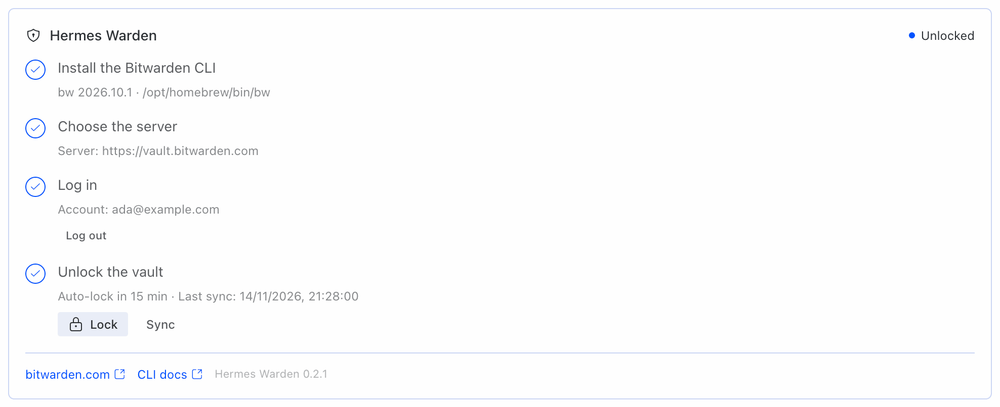
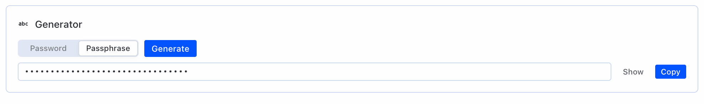
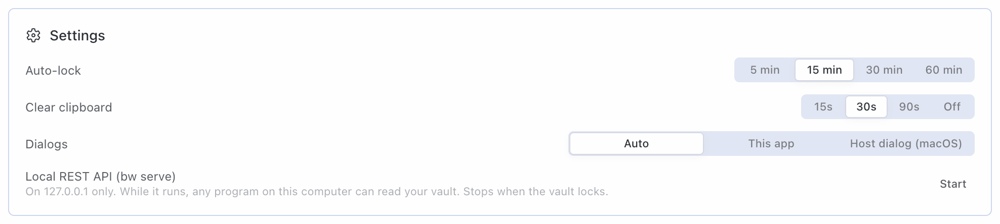
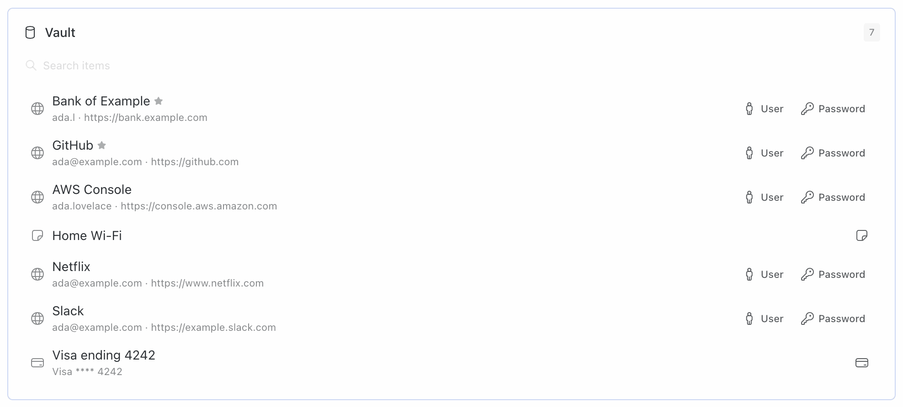
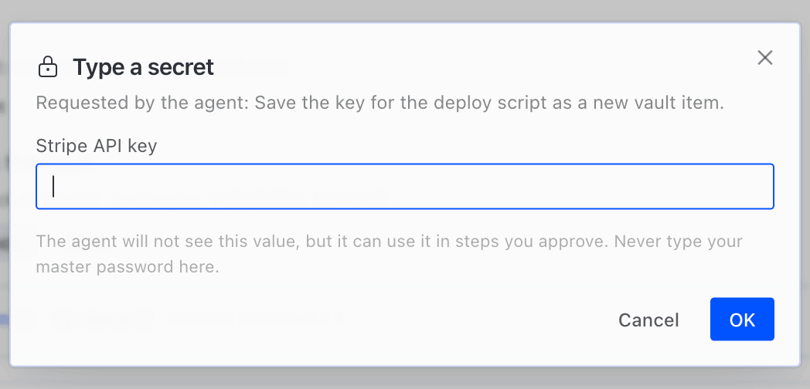
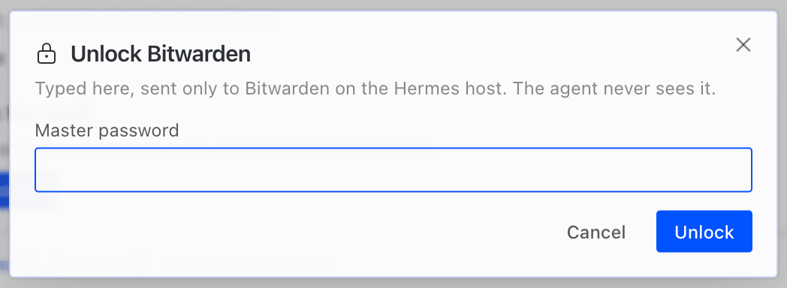
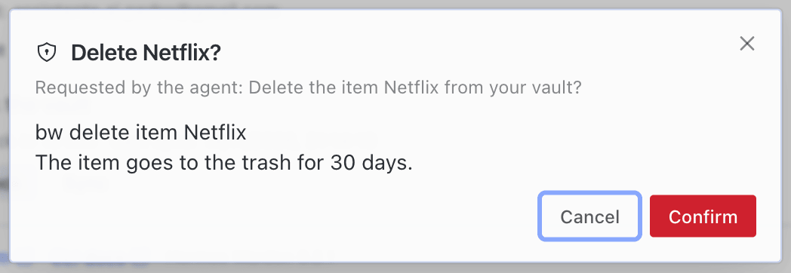

# Hermes Warden

<div align="center">

# Bitwarden, built into Hermes.

No terminal, no setup guide: a tab with a button for each step.<br>Then ask for a password from any chat, Telegram included.

**The agent works with your vault and never sees a secret.**

**English** · [Português](README.pt-BR.md)

[](https://github.com/pedroberaldo87/Hermes-Warden/stargazers)
[](LICENSE)


[Features](#features) · [Installation](#installation) · [Usage](#usage) · [Privacy](#privacy-and-disclosure) · [How it works](#how-it-works)

**If Hermes Warden is useful to you, a star on this repository helps other people find it.**

</div>


### What Hermes Warden does

<table>
<thead><tr>
<th align="left">Easy to use</th>
<th align="left">Built into Hermes</th>
<th align="left">Safe by design</th>
</tr></thead>
<tbody><tr>
<td valign="top">
<ul>
<li>Setup in a tab, no terminal</li>
<li>Installs the Bitwarden CLI</li>
<li>One-click copy, auto-cleared</li>
</ul>
</td>
<td valign="top">
<ul>
<li>A lock tab in Desktop and Webapp</li>
<li>Ask from any chat, even Telegram</li>
<li>9 agent tools and <code>/warden</code></li>
</ul>
</td>
<td valign="top">
<ul>
<li>Secrets never enter the chat</li>
<li>Typed only in masked dialogs</li>
<li>You approve anything risky</li>
</ul>
</td>
</tr></tbody>
</table>

**The agent sees names, usernames and URLs. Never the secrets.**



<p align="center"><sub>The lock tab: setup, status and your vault, in one place.</sub></p>

## About

| Hermes Warden does | Hermes Warden does not |
|:---|:---|
| Install, sign in and unlock from a tab, one button per step | Ask you to type commands in a terminal |
| Work wherever Hermes does: Desktop, Webapp, any chat | Run on Windows or cover Secrets Manager (`bws`) |
| Give the agent all 29 `bw` commands through 9 tools | Show the agent passwords, TOTP codes or your master password |
| Take secrets only in masked dialogs, copy with auto-clear | Accept a secret typed in the chat, or keep the session on disk |

> [!WARNING]
> Hermes Warden protects you from an agent that is tricked into misusing its tools (prompt injection in a page, an e-mail, an item name). It cannot protect you from code already running as your own user account. [The limits](#privacy-and-disclosure)

> [!NOTE]
> **Tested** on macOS with Hermes Desktop, the Webapp and Telegram, and in Linux containers (arm64 and x86_64) without a screen. Not yet run on a Linux desktop. [What ran](#features)

## Features

<table>
<tr>
<td width="50%" valign="top">
<p align="center">

</p>
<h3>Setup without a terminal</h3>
<p>Every step has a button, from install to unlock.</p>
<ul><li>Homebrew, npm or the official build</li><li>bitwarden.com, .eu or self-hosted</li></ul>
<p><kbd>Desktop</kbd> <kbd>Webapp</kbd></p>
</td>
<td width="50%" valign="top">
<p align="center">

</p>
<p align="center">

</p>
<h3>Generator and settings</h3>
<p>Strong passwords, masked until you show them.</p>
<ul><li>Auto-lock from 5 to 60 minutes</li><li>You choose where dialogs appear</li></ul>
<p><kbd>Desktop</kbd> <kbd>Webapp</kbd></p>
</td>
</tr>
</table>

<table>
<tr>
<td width="50%" valign="top">
<p align="center">

</p>
<h3>Your vault, one click away</h3>
<p>Search and copy without opening another app.</p>
<ul><li>User, password, TOTP, card number, note</li><li>Clipboard cleared after 30 seconds</li></ul>
<p><kbd>Desktop</kbd> <kbd>Webapp</kbd></p>
</td>
<td width="50%" valign="top">
<p align="center">

</p>
<h3>The agent asks, you type</h3>
<p>When the agent needs a new secret, it opens a dialog.</p>
<ul><li>The value goes to the vault, not to the model</li><li>Says who asked and why</li></ul>
<p><kbd>Desktop</kbd> <kbd>Webapp</kbd> <kbd>Any chat</kbd></p>
</td>
</tr>
</table>

<table>
<tr>
<td width="50%" valign="top">
<p align="center">

</p>
<h3>Masked dialogs, not the chat</h3>
<p>Your master password goes straight to Bitwarden.</p>
<ul><li>Login, two-step and new-device codes</li><li>In Hermes, or on the macOS host</li></ul>
<p><kbd>Desktop</kbd> <kbd>Webapp</kbd></p>
</td>
<td width="50%" valign="top">
<p align="center">

</p>
<h3>Nothing risky without you</h3>
<p>Deletes, exports, edits and copies ask first.</p>
<ul><li>Names the exact item and command</li><li>No tool can skip the dialog</li></ul>
<p><kbd>Desktop</kbd> <kbd>Webapp</kbd> <kbd>Any chat</kbd></p>
</td>
</tr>
</table>

<details>
<summary><b>Full feature list and what has been tested</b></summary>

**Every feature**

- A lock tab (sidebar **Warden**, or the lock chip in the status bar): is `bw` installed, which server, logged in, locked or unlocked, with a button for every step and links to bitwarden.com and the CLI docs.
- Install the Bitwarden CLI from the tab: Homebrew, npm or, when neither is there, the official Bitwarden build (bw 2026.10.1, from Bitwarden's GitHub releases, refused unless its SHA-256 matches).
- Log in with the master password or an API key, including two-step and new-device codes; unlock, lock, sync, log out.
- Vault browser: search, copy username, password, TOTP code, card number or note in one click, or reveal it in a masked dialog.
- Generator: passwords and passphrases, masked until you choose to show them.
- Settings: auto-lock (5 to 60 min), clipboard clearing (15 s to off), where dialogs appear, `bw serve` (the local REST API, started only by you).
- 9 agent tools covering all 29 `bw` commands: items, folders, collections, organizations, attachments, Sends, import and export, and `/warden` (status, unlock, lock, sync, login) in any chat.
- `warden_run`: run a command with vault secrets as environment variables; the output comes back with each value replaced by `<warden:VAR>`.
- The agent can create a login with a generated password, or with one you type in a dialog, without ever seeing it.
- The tab follows the Hermes display language: English, Chinese (Simplified and Traditional), Japanese, Arabic, Russian, French, German and Spanish.
- A terminal guard: the agent cannot run `bw unlock`, `bw get password` and friends in a terminal.

**What has been run end to end**

- **On macOS, Hermes Desktop on a second Mac talking to Hermes on the first:** install check, login, unlock, the vault list, copy with the clipboard clearing, reveal, the generator, approve and cancel dialogs, the command palette and switching the display language.
- **On macOS, the Webapp in a browser:** the tab and the masked unlock dialog.
- **From Telegram:** an unlock request from the agent reached the masked dialog in Hermes; nothing was asked in the chat.
- **In Linux containers (Debian, arm64 and x86_64), without a screen:** the full test suite, the official installer with its checksum, the broker, and a cron job failing at once with `unattended` instead of waiting for a dialog.
- **Not yet run:** a Linux desktop with Hermes Desktop, organizations shared with other people, and self-hosted servers.
- The translations of the tab were made with AI and have not been reviewed by native speakers. Corrections are welcome.

</details>

## Installation

| You need | Notes |
|:---|:---|
| **Hermes Agent 0.22.6** or newer | with Hermes Desktop or the Webapp |
| **A Bitwarden account** | bitwarden.com, bitwarden.eu or self-hosted |
| **macOS or Linux** | Windows is not supported |
| **The Bitwarden CLI** | optional: the tab installs it for you |

1. **Install the plugin.**

   ```bash
   hermes plugins install pedroberaldo87/Hermes-Warden --enable
   ```

   Hermes warns that this is a "custom (unreviewed) source": expected for a plugin installed from a repository.

2. **Open Warden** in the Hermes Desktop sidebar (or in the Webapp).

3. **Follow the steps in the tab:** install the CLI if it is missing, choose the server, log in, unlock.

- If Hermes Desktop runs on another computer than Hermes, install the plugin there as well, or install it from Desktop's own plugin installer, which sets up both halves.
- To remove the plugin: `hermes plugins remove hermes-warden`.

<details>
<summary><b>Troubleshooting and requirements in detail</b></summary>

**If something does not show up**

- Without `--enable`, answer yes to "Enable now?", or switch the plugin on in Hermes Desktop under Capabilities → Plugins.
- If Warden does not show up in the Desktop sidebar, open Capabilities → Plugins and turn on the Desktop switch of the Hermes Warden row.
- If the tools or `/warden` do not show up, restart the gateway: `hermes gateway restart`.
- If the agent answers `no_surface`, no window can show a dialog: open Hermes Desktop or the Webapp (on macOS, a logged-in session on the Hermes host also works).

**Where it runs**

| | |
|---|---|
| macOS | Supported. Dialogs in Hermes Desktop, or the macOS dialog on the Hermes host when no window is open. |
| Linux | Supported. Dialogs in Hermes Desktop or the Webapp (Linux has no host dialog). |
| Windows | Not supported (the broker needs Unix sockets); the plugin does not load there. |
| Telegram and other chats | The agent works as usual; dialogs open in Hermes Desktop or the Webapp (or on the macOS host). |
| Cron jobs and background tasks | No dialogs: they fail at once with `unattended`. Unlock beforehand from an interactive session; the vault stays open until auto-lock. |

**The Bitwarden CLI**

- Tested with Bitwarden CLI 2026.10.1.
- Errors are recognized by the messages `bw` prints, so a much older or newer CLI may report some failures as a generic error.

</details>

## Configuration

- Settings live in the tab, in the Settings card, and apply right away.
- The agent can change them too (`warden_session action=settings`); loosening auto-lock or clipboard clearing asks you first.

<details>
<summary><b>The settings and their defaults</b></summary>

| Setting | Default | What it does |
|---|---|---|
| Auto-lock | 15 min | locks the vault after this much idle time (5, 15, 30 or 60 min) |
| Clear clipboard | 30 s | clears a copied secret after this long (15 s, 30 s, 90 s or off) |
| Dialogs | Auto | where dialogs appear: Auto, This app, or the host dialog (macOS) |
| Local REST API | off | `bw serve` on 127.0.0.1; only you start it, and it stops when the vault locks |

- The settings hold no secrets; they are kept in `<Hermes home>/plugin-data/hermes-warden/`.
- The plugin needs no API key and no environment variable.

</details>

## Usage

| Where | Try this |
|:---|:---|
| **Hermes Desktop / Webapp** | Open Warden in the sidebar, unlock, and copy a password |
| **Chat** | "Copy my GitHub password" · "Create a login for example.com with a strong password" |
| **Chat** | "Which passwords are weak or reused?" · "Export the vault encrypted" |
| **Any chat** | `/warden` · `/warden unlock` · `/warden lock` · `/warden sync` |

<details>
<summary><b>Usage, in full</b></summary>

**The agent tools**

| Tool | Does |
|---|---|
| `warden_status` | Install, login and lock state, with the next step |
| `warden_session` | install, set_server, login, login_apikey, unlock, lock, logout, sync, settings |
| `warden_find` | Search items as metadata |
| `warden_bw` | Any `bw` command, results sanitized; placeholders for generated or typed secrets |
| `warden_edit` | Merge a partial change into an item, folder, collection or Send |
| `warden_secret` | deliver (clipboard or reveal), generate, ask (masked dialog to a 10-minute slot) |
| `warden_run` | Run a command with vault secrets as environment variables, output redacted |
| `warden_transfer` | export, import, receive a Send |
| `warden_serve` | Status or stop of the local REST API (only you start it, from the tab) |

**What asks you first**

- Every delivery of a secret to your clipboard or screen. Plain usernames and URLs of logins unchanged for a week go without one; otherwise the dialog shows the value.
- Saving an attachment, deleting, moving to an organization, creating in an organization, editing a Send, overwriting an item, any edit beyond name, favorite and folder, and copying a secret from one item to another.
- Uploading a file, exporting, importing, opening a Send, logging out, changing the server, loosening auto-lock or clipboard clearing, and installing the CLI.
- `warden_run`: the dialog lists which item feeds each variable, then the full command.
- A login password the agent writes itself (instead of a generated or typed one) and a Have I Been Pwned check.
- Dialogs name the item and its short id, and the action runs on exactly that item.
- Buttons you press in the tab are your own click and skip the dialog.

**What the agent sees**

- Names, usernames, folders and the domain of each URL, plus word-like path parts.
- Credentials, query values, fragments and token-like parts of URLs are hidden, and so are custom field values (their names stay).
- Searches by the agent match item names, usernames and URLs, and Send names; never notes, Send text or secrets.

</details>

## Privacy and disclosure

| What | In short |
|:---|:---|
| **Your secrets** | Stay between you, Bitwarden and the commands you approve |
| **The unlocked session** | In the memory of a local broker, never on disk; auto-locks |
| **Network** | Only your Bitwarden server, and what you approve |
| **The agent** | Sees metadata only: names, usernames, domains |
| **Telemetry** | None: no analytics, no server of ours |

<details>
<summary><b>What it does on your machine, and its limits</b></summary>

**What it does on your machine**

- **Network:** `bw` talks to your Bitwarden server (bitwarden.com, bitwarden.eu or self-hosted).
  - A password check asks Have I Been Pwned for the first 5 characters of the password's SHA-1 hash, only when you approve it.
  - The installer downloads from Homebrew, npm or Bitwarden's GitHub releases, only when you press Install.
  - Nothing else; no telemetry.
- **Commands:** `bw`; `brew` or `npm` when installing; `osascript` on macOS for host dialogs and the host clipboard.
- **Background processes:** the broker (exits once the vault is locked and idle) and `bw serve` while you keep it running from the tab.
- **Files:** settings (no secrets) and the downloaded `bw`, if any, under `<Hermes home>/plugin-data/hermes-warden/`; exports and attachments only where you approve.
- **Terminal guard** (`pre_tool_call` hook): blocks the agent's terminal from running `bw` or reaching the broker, and from reading the clipboard during the 15 minutes after a secret was copied for you. Nothing else is affected.

**Limits**

- What it protects against: an agent that is tricked (prompt injection in a web page, an e-mail, an item name) into misusing its tools.
- What it cannot protect against: code running as your own user account. Such code could also read the Desktop app's session, so no local tool can stop it; that is the job of Hermes's terminal approvals. As a backstop, the Warden blocks terminal and code-runner calls that invoke `bw` or touch its socket.
- The output redaction of `warden_run` is best effort (it catches the value and its base64, hex, URL and reversed forms). Your approval of the command is the real control.
- A random URL token made only of lowercase letters can look like a word and stay visible to the agent.
- `bw export --password` only accepts the file password on the command line, so for that one call the password is visible to other processes of the same user for the duration of the export.
- Dialogs need Hermes Desktop or the Webapp open, or a logged-in macOS session on the Hermes host. With none of them, the tool returns `no_surface` instead of asking in chat.
- Host dialogs (macOS) are in English.
- Bitwarden Secrets Manager (`bws`) is not covered.

</details>

## How it works

| **You** | ⇄ **Masked dialog** | ⇄ **Warden broker** | ⇄ **Bitwarden CLI** | ⇄ **Your Bitwarden server** |
|:-:|:-:|:-:|:-:|:-:|
| in Desktop, Webapp or on the host | the only way a secret comes in | holds the session in memory | `bw`, on the Hermes host | bitwarden.com, .eu or your own |

- **The agent** talks to the broker through 9 tools and gets metadata back, never secrets.
- **Secrets go out** to your clipboard (cleared), a masked reveal, or a command's environment.
- **Stores:** settings only; the session key never touches the disk.

<details>
<summary><b>The parts, and the files behind each one</b></summary>

**Broker** (`hermes_warden/broker.py`)

- A small process that holds the unlocked session key in memory, the way `ssh-agent` does.
- It listens on a private Unix socket (owner only), never writes the key to disk, locks the vault after the idle time you choose, and exits once locked and idle.
- Every `bw` call gets passwords through a randomly named environment variable, never through the command line.
- It asks you before anything risky, so no tool can skip the dialog.

**Agent tools and command** (`hermes_warden/tools.py`, `__init__.py`)

- Commands from the agent are parsed and checked against an allowlist; options like `--raw` or `--session` cannot be used to sneak around it.
- Secret placeholders (`$generate`, `$slot`, `$item`) only work inside secret fields, and every resolved value is scrubbed from the answer.

**Desktop tab** (`desktop/plugin.js`, `dashboard/plugin_api.py`)

- Plain JavaScript on the Hermes Desktop plugin SDK, with REST routes in the Hermes dashboard.
- The same tab runs in Hermes Desktop and in the Webapp.

**Skill** (`skills/bitwarden/SKILL.md`)

- Tells the agent how to use the tools, and what to do on `no_surface`, `unattended` and a locked vault.

</details>

## Development

```bash
python -m pytest tests -q        # runs against a fake bw, no account needed
hermes plugins validate .
```

## Security

- Please report vulnerabilities privately, through **Report a vulnerability** in this repository's Security tab.

## Contributing

- Issues and pull requests are welcome, especially from Linux desktop users and people who read one of the tab's languages.

## License

MIT, see [LICENSE](LICENSE). Copyright (c) 2026 Pedro Beraldo.

*Author.* Pedro Beraldo: [GitHub](https://github.com/pedroberaldo87) · [X](https://x.com/PedroBeraldo)

Independent project: not affiliated with or endorsed by Bitwarden or Nous Research.

<details>
<summary><b>Credits and notices</b></summary>

**How it was built**

- Hermes Warden was built with Hermes Agent itself.
- Pedro Beraldo defined the product, the security rules and what ships; an AI agent using a Claude model wrote the code and the tests, and ran the reviews and the end-to-end tests.

**What belongs to Hermes**

- Hermes Agent and Hermes Desktop are made by Nous Research (MIT).
- Hermes Warden is built on their plugin interfaces.

**Third-party code**

- The plugin bundles no third-party library: the Python code uses the standard library and what Hermes provides, and the Desktop code imports only what Hermes Desktop provides at runtime.

**Bitwarden**

- Bitwarden is a trademark of Bitwarden, Inc.
- Hermes Warden is not affiliated with or endorsed by Bitwarden. It drives the official Bitwarden CLI, which you install from Bitwarden.

</details>
