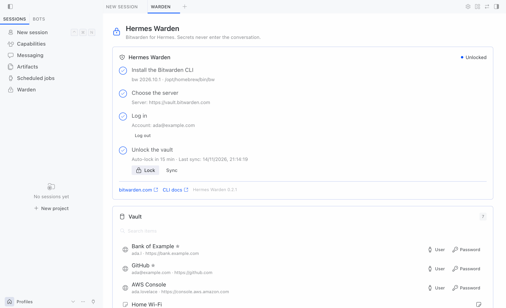
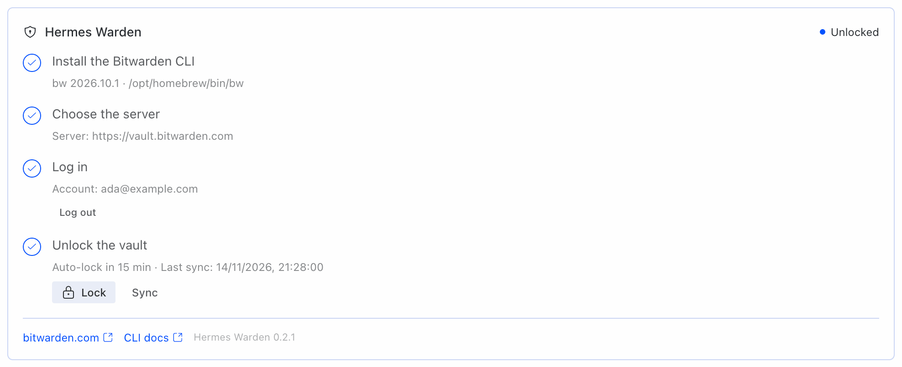
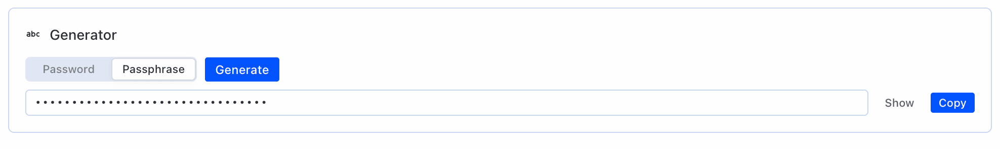
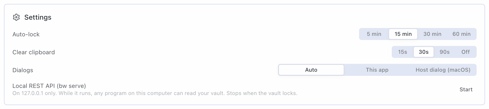
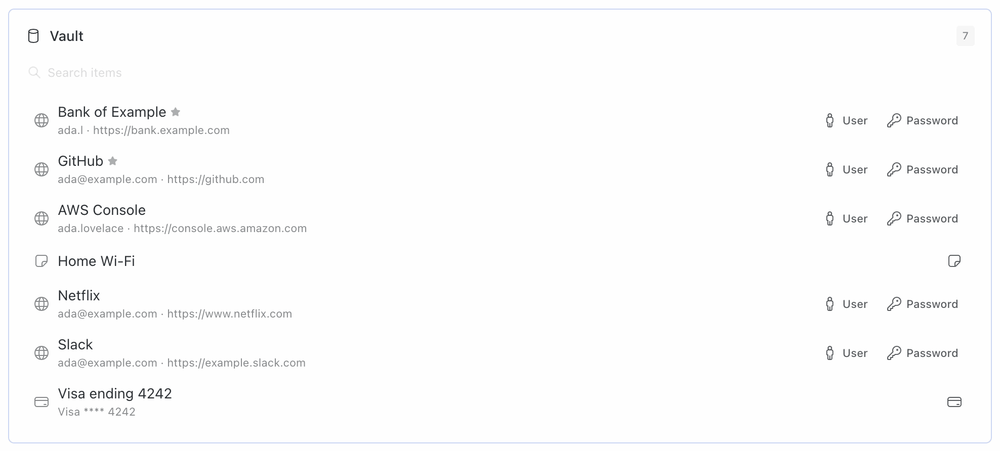
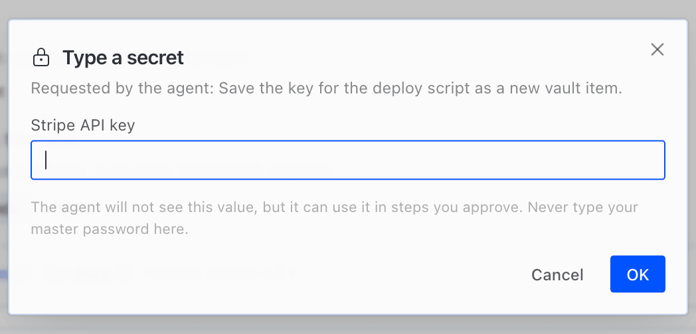
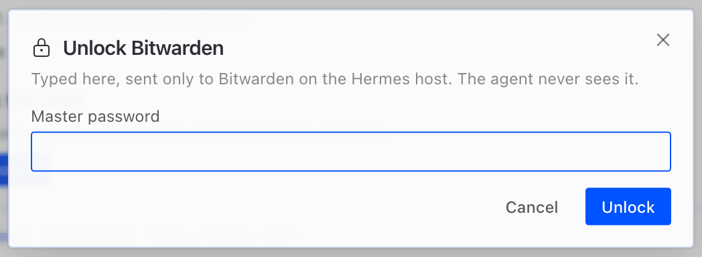
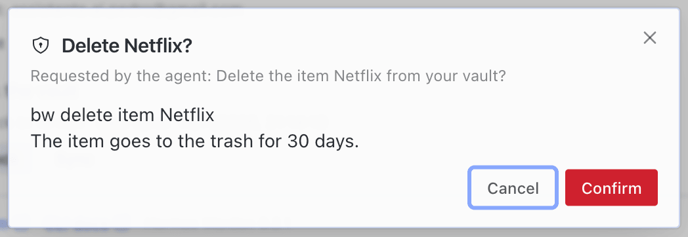

# Hermes Warden

<div align="center">

# O Bitwarden, dentro do Hermes.

Sem terminal e sem tutorial: uma aba com um botão para cada passo.<br>Depois é só pedir uma senha em qualquer chat, até no Telegram.

**O agente trabalha com o seu cofre e nunca lê um segredo dele.**

[English](README.md) · **Português**

[](https://github.com/pedroberaldo87/Hermes-Warden/stargazers)
[](LICENSE)


[Recursos](#recursos) · [Instalação](#instalação) · [Uso](#uso) · [Privacidade](#privacidade-e-transparência) · [Como funciona](#como-funciona) · [Arquitetura](docs/architecture.md) · [Changelog](CHANGELOG.md)

**Se o Hermes Warden for útil para você, uma estrela neste repositório ajuda outras pessoas a encontrá-lo.**

</div>


### O que o Hermes Warden faz

<table>
<thead><tr>
<th align="left">Fácil de usar</th>
<th align="left">Integrado ao Hermes</th>
<th align="left">Seguro por construção</th>
</tr></thead>
<tbody><tr>
<td valign="top">
<ul>
<li>Tudo numa aba, sem terminal</li>
<li>Instala o Bitwarden CLI</li>
<li>Cópia num clique, limpa sozinha</li>
</ul>
</td>
<td valign="top">
<ul>
<li>Uma aba no Desktop e no Webapp</li>
<li>Peça de qualquer chat, até Telegram</li>
<li>9 ferramentas do agente e <code>/warden</code></li>
</ul>
</td>
<td valign="top">
<ul>
<li>Segredos nunca entram no chat</li>
<li>Só em diálogos mascarados</li>
<li>Você aprova o que for arriscado</li>
</ul>
</td>
</tr></tbody>
</table>

**O agente vê nomes, usuários e URLs, não os segredos do cofre.**



<p align="center"><sub>A aba do cadeado: configuração, estado e o seu cofre, num lugar só.</sub></p>

## Sobre

| O Hermes Warden faz | O Hermes Warden não faz |
|:---|:---|
| Instala, faz login e destranca por uma aba, um botão por passo | Pedir que você digite comandos no terminal |
| Funciona onde o Hermes estiver: Desktop, Webapp, qualquer chat | Rodar no Windows ou cobrir o Secrets Manager (`bws`) |
| Dá ao agente os 29 comandos do `bw` por 9 ferramentas | Mostrar ao agente senhas, códigos TOTP ou a senha mestra |
| Segredos só em diálogo mascarado; cópia que se limpa | Aceitar segredo digitado no chat, ou guardar a sessão em disco |

> [!WARNING]
> O Hermes Warden protege você de um agente enganado para usar mal as ferramentas (prompt injection numa página, num e-mail, no nome de um item). Ele não protege de código que já roda como o seu próprio usuário do sistema. [Os limites](#privacidade-e-transparência)

> [!NOTE]
> **Testado** no macOS com o Hermes Desktop, o Webapp e o Telegram, e em containers Linux (arm64 e x86_64) sem tela. Ainda não rodou num Linux com interface gráfica. [O que rodou](#recursos)

## Recursos

<table>
<tr>
<td width="50%" valign="top">
<p align="center">

</p>
<h3>Configuração sem terminal</h3>
<p>Cada passo tem um botão, da instalação ao destrancar.</p>
<ul><li>Homebrew, npm ou a versão oficial</li><li>bitwarden.com, .eu ou servidor próprio</li></ul>
<p><kbd>Desktop</kbd> <kbd>Webapp</kbd></p>
</td>
<td width="50%" valign="top">
<p align="center">

</p>
<p align="center">

</p>
<h3>Gerador e ajustes</h3>
<p>Senhas fortes, mascaradas até você pedir para ver.</p>
<ul><li>Tranca sozinho de 5 a 60 minutos</li><li>Você escolhe onde os diálogos aparecem</li></ul>
<p><kbd>Desktop</kbd> <kbd>Webapp</kbd></p>
</td>
</tr>
</table>

<table>
<tr>
<td width="50%" valign="top">
<p align="center">

</p>
<h3>O cofre a um clique</h3>
<p>Busque e copie sem abrir outro app.</p>
<ul><li>Usuário, senha, TOTP, número do cartão, nota</li><li>Área de transferência limpa em 30 segundos</li></ul>
<p><kbd>Desktop</kbd> <kbd>Webapp</kbd></p>
</td>
<td width="50%" valign="top">
<p align="center">

</p>
<h3>O agente pede, você digita</h3>
<p>Quando o agente precisa de um segredo novo, ele abre um diálogo.</p>
<ul><li>O valor vai para o cofre, não para o modelo</li><li>Mostra quem pediu e por quê</li></ul>
<p><kbd>Desktop</kbd> <kbd>Webapp</kbd> <kbd>Qualquer chat</kbd></p>
</td>
</tr>
</table>

<table>
<tr>
<td width="50%" valign="top">
<p align="center">

</p>
<h3>Diálogo mascarado, não o chat</h3>
<p>A senha mestra vai direto para o Bitwarden.</p>
<ul><li>Login, código de duas etapas e de novo dispositivo</li><li>No Hermes, ou no host macOS</li></ul>
<p><kbd>Desktop</kbd> <kbd>Webapp</kbd></p>
</td>
<td width="50%" valign="top">
<p align="center">

</p>
<h3>Nada arriscado sem você</h3>
<p>Apagar, exportar, editar e copiar pedem antes.</p>
<ul><li>Mostra o item e o comando exatos</li><li>Nenhuma ferramenta pula o diálogo</li></ul>
<p><kbd>Desktop</kbd> <kbd>Webapp</kbd> <kbd>Qualquer chat</kbd></p>
</td>
</tr>
</table>

<details>
<summary><b>Lista completa de recursos e o que foi testado</b></summary>

**Todos os recursos**

- Uma aba de cadeado (linha **Warden** na barra lateral, ou o cadeado na barra de status): se o `bw` está instalado, qual servidor, se está logado, trancado ou destrancado, com um botão para cada passo e links para bitwarden.com e a documentação do CLI.
- Instalar o Bitwarden CLI pela aba: Homebrew, npm (fixado no bw 2026.10.1) ou, sem nenhum dos dois, a versão oficial da Bitwarden (o mesmo bw 2026.10.1, das releases da Bitwarden no GitHub, recusada se o SHA-256 não bater).
- Login com senha mestra ou chave de API, incluindo código de duas etapas e de novo dispositivo; destrancar, trancar, sincronizar, sair.
- Navegador do cofre: busca e cópia de usuário, senha, código TOTP, número do cartão ou nota num clique, ou exibição num diálogo mascarado.
- Gerador: senhas e frases-senha, mascaradas até você pedir para ver.
- Ajustes: trancar após 5 a 60 min, limpeza da área de transferência (15 s a desligada), onde os diálogos aparecem, `bw serve` (a API REST local, ligada só por você).
- 9 ferramentas do agente cobrindo os 29 comandos do `bw`: itens, pastas, coleções, organizações, anexos, Sends, importação e exportação, e `/warden` (status, unlock, lock, sync, login) em qualquer chat.
- `warden_run`: roda um comando com segredos do cofre como variáveis de ambiente; a saída volta com cada valor trocado por `<warden:VAR>`.
- O agente consegue criar um login com senha gerada, ou com uma que você digita num diálogo, sem nunca vê-la.
- A aba segue o idioma do Hermes: inglês, chinês (simplificado e tradicional), japonês, árabe, russo, francês, alemão e espanhol.
- Uma trava no terminal: o agente não consegue rodar `bw unlock`, `bw get password` e similares no terminal.

**O que rodou de ponta a ponta**

- **No macOS, com o Hermes Desktop num segundo Mac falando com o Hermes do primeiro:** checagem da instalação, login, destrancar, a lista do cofre, cópia com limpeza da área de transferência, exibição mascarada, o gerador, diálogos confirmados e cancelados, a paleta de comandos e a troca de idioma.
- **No macOS, com o Webapp num navegador:** a aba e o diálogo mascarado de destrancar.
- **Pelo Telegram:** um pedido de destrancar feito pelo agente chegou ao diálogo mascarado no Hermes; nada foi pedido no chat.
- **Em containers Linux (Debian, arm64 e x86_64), sem tela:** a suíte de testes completa, o instalador oficial com a checagem do hash, o broker e um cron falhando na hora com `unattended` em vez de esperar um diálogo.
- **Ainda não rodou:** um Linux com interface gráfica e o Hermes Desktop, organizações compartilhadas com outras pessoas e servidores próprios.
- As traduções da aba foram feitas com IA e não foram revisadas por falantes nativos. Correções são bem-vindas.

</details>

## Instalação

| Você precisa de | Observações |
|:---|:---|
| **Hermes Agent 0.22.6** ou mais novo | com o Hermes Desktop ou o Webapp |
| **Uma conta Bitwarden** | bitwarden.com, bitwarden.eu ou servidor próprio |
| **macOS ou Linux** | o Windows não é suportado |
| **O Bitwarden CLI** | opcional: a aba instala para você |

1. **Instale o plugin.**

   ```bash
   hermes plugins install pedroberaldo87/Hermes-Warden --enable
   ```

   O Hermes avisa que é uma "custom (unreviewed) source": é o esperado para um plugin instalado de um repositório.

2. **Abra o Warden** na barra lateral do Hermes Desktop (ou no Webapp).

3. **Siga os passos da aba:** instale o CLI se faltar, escolha o servidor, faça login, destranque.

- Se o Hermes Desktop roda em outro computador, instale o plugin lá também, ou instale pelo instalador de plugins do próprio Desktop, que prepara as duas metades.
- Para remover o plugin: `hermes plugins remove hermes-warden`.

<details>
<summary><b>Problemas comuns e requisitos em detalhe</b></summary>

**Se algo não aparecer**

- Sem `--enable`, responda sim a "Enable now?", ou ligue o plugin no Hermes Desktop em Capabilities → Plugins.
- Se o Warden não aparecer na barra lateral do Desktop, abra Capabilities → Plugins e ligue a chave Desktop da linha do Hermes Warden.
- Se as ferramentas ou o `/warden` não aparecerem, reinicie o gateway: `hermes gateway restart`.
- Depois de atualizar (`hermes plugins update hermes-warden`), reinicie o gateway do mesmo jeito para ele carregar o código novo. O cofre tranca uma vez: destrave de novo. Se uma ferramenta responder `restarted`, peça de novo e um diálogo novo abre.
- Desde a 0.1.2, cada perfil do Hermes tem o seu próprio Warden. Se você usava o Warden a partir de um perfil com nome, esse perfil pede o login do Bitwarden uma vez e começa com os ajustes padrão. O perfil padrão mantém o login e os ajustes.
- Se um comando do `warden_run` não achar uma variável que antes enxergava, inclua-a em `env` a partir de um item do cofre: o comando não herda mais o ambiente do Hermes.
- Se o agente responder `no_surface`, nenhuma janela pode mostrar um diálogo: abra o Hermes Desktop ou o Webapp (no macOS, uma sessão logada no host do Hermes também serve).

**Onde funciona**

| | |
|---|---|
| macOS | Funciona. Diálogos no Hermes Desktop, ou o diálogo do macOS no host do Hermes quando nenhuma janela está aberta. |
| Linux | Funciona. Diálogos no Hermes Desktop ou no Webapp (o Linux não tem diálogo no host). |
| Windows | Não funciona (o broker precisa de sockets Unix); o plugin não carrega. |
| Telegram e outros chats | O agente trabalha normalmente; os diálogos abrem no Hermes Desktop ou no Webapp (ou no host macOS). |
| Cron e tarefas em segundo plano | Sem diálogos: falham na hora com `unattended`. Destranque antes numa sessão interativa; o cofre fica aberto até trancar sozinho. |

**O Bitwarden CLI**

- Testado com o Bitwarden CLI 2026.10.1.
- Os erros são reconhecidos pelas mensagens que o `bw` imprime; um CLI muito mais antigo ou novo pode mostrar algumas falhas como erro genérico.

</details>

## Configuração

- Os ajustes ficam na aba, no cartão Settings, e valem na hora.
- O agente também pode mudá-los (`warden_session action=settings`); afrouxar o trancamento ou a limpeza da área de transferência pede confirmação.

<details>
<summary><b>Os ajustes e os valores padrão</b></summary>

| Ajuste | Padrão | O que faz |
|---|---|---|
| Auto-lock | 15 min | tranca o cofre depois desse tempo parado (5, 15, 30 ou 60 min) |
| Clear clipboard | 30 s | limpa um segredo copiado depois desse tempo (15 s, 30 s, 90 s ou desligado) |
| Dialogs | Auto | onde os diálogos aparecem: Auto, neste app ou o diálogo do host (macOS) |
| Local REST API | desligada | `bw serve` em 127.0.0.1; só você liga, e ela para quando o cofre tranca |

- Os ajustes não guardam segredos; ficam em `<pasta do Hermes>/plugin-data/hermes-warden/`.
- O plugin não precisa de chave de API nem de variável de ambiente.

</details>

## Uso

| Onde | Experimente |
|:---|:---|
| **Hermes Desktop / Webapp** | Abra o Warden na barra lateral, destranque e copie uma senha |
| **Chat** | "Copia minha senha do GitHub" · "Cria um login para example.com com uma senha forte" |
| **Chat** | "Quais senhas estão fracas ou repetidas?" · "Exporta o cofre criptografado" |
| **Qualquer chat** | `/warden` · `/warden unlock` · `/warden lock` · `/warden sync` |

<details>
<summary><b>Uso, completo</b></summary>

**As ferramentas do agente**

| Ferramenta | Faz |
|---|---|
| `warden_status` | Estado de instalação, login e tranca, com o próximo passo |
| `warden_session` | install, set_server, login, login_apikey, unlock, lock, logout, sync, settings |
| `warden_find` | Busca itens como metadados |
| `warden_bw` | Qualquer comando `bw`, resultado higienizado; marcadores para segredos gerados ou digitados |
| `warden_edit` | Mescla uma mudança parcial num item, pasta, coleção ou Send |
| `warden_secret` | deliver (área de transferência ou exibição), generate, ask (diálogo mascarado para um espaço de 10 min) |
| `warden_run` | Roda um comando com segredos do cofre como variáveis de ambiente, saída censurada |
| `warden_transfer` | export, import, receive de um Send |
| `warden_serve` | Estado ou parada da API REST local (só você liga, pela aba) |

**Quando o cofre se tranca sozinho**

- As ferramentas do agente aceitam `keep_open` (padrão `true`): cada chamada que toca o cofre o deixa aberto para a próxima do mesmo fluxo, com uma janela de 90 segundos. A resposta traz `_warden_session` com os segundos restantes e o lembrete de encerrar com `warden_session action=lock`; o vigia tranca o cofre sozinho se o fluxo for abandonado. Passe `keep_open: false` para trancar logo após a chamada; um segredo gerado ou digitado (um espaço) mantém a janela porque a próxima chamada o consome.
- Na aba, copiar um segredo (senha, usuário, URL, cartão, campo de nota) tranca o cofre imediatamente após a cópia, e a área de transferência se limpa no prazo dela. Nenhuma janela extra enquanto você está longe do teclado.
- O trancamento por inatividade (15 minutos por padrão) continua valendo para o que ficou aberto por um login que você iniciou na aba, e o vigia nunca tranca no meio de uma chamada em andamento.

**O que pede confirmação**

- Toda entrega de segredo para a sua área de transferência ou tela. Usuário e URL simples de logins sem mudança há uma semana vão sem diálogo; nos outros casos o diálogo mostra o valor.
- Salvar um anexo, apagar, mover para organização, criar dentro de organização, editar um Send, sobrescrever um item, qualquer edição além de nome, favorito e pasta, e copiar um segredo de um item para outro.
- Enviar arquivo, exportar, importar, abrir um Send, sair da conta, trocar o servidor, afrouxar o trancamento ou a limpeza da área de transferência e instalar o CLI.
- `warden_run`: o diálogo lista de qual item vem cada variável e depois o comando inteiro.
- Senha de login escrita pelo próprio agente (em vez de gerada ou digitada) e checagem no Have I Been Pwned.
- Os diálogos mostram o nome do item e o id curto, e a ação roda exatamente naquele item.
- Botões que você aperta na aba são o seu próprio clique e não pedem de novo.

**O que o agente vê**

- Nomes, usuários, pastas e o domínio de cada URL, mais as partes do caminho que parecem palavras.
- Credenciais, valores de query, fragmentos e trechos com cara de token ficam ocultos, assim como os valores de campos personalizados (os nomes aparecem).
- As buscas do agente olham nome do item, usuário e URL, e nome de Send; nunca notas, texto de Send nem segredos.

</details>

## Privacidade e transparência

| O quê | Em resumo |
|:---|:---|
| **Seus segredos** | Ficam entre você, o Bitwarden e os comandos que você aprova |
| **A sessão destrancada** | Na memória de um broker local, nunca em disco; tranca sozinha |
| **Rede** | Só o seu servidor Bitwarden, e o que você aprovar |
| **O agente** | Vê só metadados: nomes, usuários, domínios |
| **Telemetria** | Nenhuma: sem analytics, sem servidor nosso |

<details>
<summary><b>O que ele faz na sua máquina, e os limites</b></summary>

**O que ele faz na sua máquina**

- **Rede:** o `bw` fala com o seu servidor Bitwarden (bitwarden.com, bitwarden.eu ou próprio).
  - A checagem de senha vazada manda ao Have I Been Pwned os 5 primeiros caracteres do hash SHA-1 da senha, só quando você aprova.
  - O instalador baixa do Homebrew, do npm ou das releases da Bitwarden no GitHub, só quando você aperta Instalar.
  - Mais nada; sem telemetria.
- **Comandos:** `bw`; `brew` ou `npm` na instalação; `osascript` no macOS para diálogos e área de transferência do host.
- **Processos em segundo plano:** o broker (encerra quando o cofre está trancado e parado) e o `bw serve` enquanto você o mantiver ligado pela aba.
- **Arquivos:** ajustes (sem segredos) e o `bw` baixado, se houver, em `<pasta do Hermes>/plugin-data/hermes-warden/`; exportações e anexos só onde você aprovar.
- **Perfis do Hermes:** cada perfil tem o seu próprio Warden: ajustes, broker e sessão destrancada próprios, na pasta daquele perfil. Destrancar o cofre num perfil não destranca nada em outro. Um perfil com nome também guarda o próprio login do Bitwarden (em `bw-data/`, na pasta dele), então você faz login uma vez por perfil; o perfil padrão usa o login que o `bw` já tem neste computador.
- **Comandos aprovados (`warden_run`):** rodam no host do Hermes com um ambiente mínimo (`PATH`, `HOME`, usuário, idioma, terminal, pasta temporária, shell, ajustes de proxy e de certificados) mais os segredos que você aprovou. As variáveis do próprio Hermes, como chaves de provedores e do gateway, não são passadas.
- **Trava do terminal** (hook `pre_tool_call`): impede o terminal do agente de rodar `bw` ou falar com o broker, e de ler a área de transferência nos 15 minutos depois de um segredo copiado para você (em todos os perfis, porque a área de transferência é uma só). Nada além disso é afetado.

**Limites**

- Contra o que protege: um agente enganado (prompt injection numa página, num e-mail, no nome de um item) a usar mal as ferramentas.
- Contra o que não protege: código rodando como o seu próprio usuário do sistema. Esse código também conseguiria ler a sessão do app Desktop, então nenhuma ferramenta local o impede; isso é papel das aprovações de terminal do Hermes. Como reforço, o Warden bloqueia chamadas de terminal e de execução de código que rodem `bw` ou mexam no socket dele.
- A censura da saída do `warden_run` é de melhor esforço (pega o valor e as formas base64, hex, URL e invertida). O controle real é a sua aprovação do comando.
- Um token aleatório de URL só com letras minúsculas pode parecer palavra e continuar visível para o agente.
- O `bw export --password` só aceita a senha do arquivo na linha de comando; nessa chamada a senha fica visível para outros processos do mesmo usuário enquanto a exportação roda.
- Os diálogos precisam do Hermes Desktop ou do Webapp aberto, ou de uma sessão macOS logada no host do Hermes. Sem nenhum deles, a ferramenta devolve `no_surface` em vez de pedir no chat.
- Os diálogos do host (macOS) são em inglês.
- O Bitwarden Secrets Manager (`bws`) não está incluído.

</details>

## Como funciona

| **Você** | ⇄ **Diálogo mascarado** | ⇄ **Broker do Warden** | ⇄ **Bitwarden CLI** | ⇄ **Seu servidor Bitwarden** |
|:-:|:-:|:-:|:-:|:-:|
| no Desktop, no Webapp ou no host | o único jeito de um segredo entrar | guarda a sessão na memória | `bw`, no host do Hermes | bitwarden.com, .eu ou o seu |

- **O agente** fala com o broker por 9 ferramentas e recebe metadados, nunca segredos.
- **Os segredos saem** para a sua área de transferência (limpa depois), uma exibição mascarada ou o ambiente de um comando.
- **Guarda:** só os ajustes; a chave de sessão nunca toca o disco.

<details>
<summary><b>As partes, e os arquivos de cada uma</b></summary>

**Broker** (`hermes_warden/broker.py`)

- Um processo pequeno que guarda a chave de sessão destrancada só na memória, como o `ssh-agent`.
- Ele escuta num socket Unix privado (só o seu usuário), nunca grava a chave em disco, tranca o cofre depois do tempo parado que você escolher e encerra quando está trancado e parado.
- Cada chamada ao `bw` recebe senhas por uma variável de ambiente de nome aleatório, nunca pela linha de comando.
- Ele pede confirmação antes de qualquer coisa arriscada, então nenhuma ferramenta pula o diálogo.

**Ferramentas e comando do agente** (`hermes_warden/tools.py`, `__init__.py`)

- Os comandos do agente são interpretados e checados contra uma lista do que é permitido; opções como `--raw` ou `--session` não servem para contornar.
- Marcadores de segredo (`$generate`, `$slot`, `$item`) só funcionam em campos secretos, e todo valor resolvido é apagado da resposta.

**Aba do Desktop** (`desktop/plugin.js`, `dashboard/plugin_api.py`)

- JavaScript puro sobre o SDK de plugins do Hermes Desktop, com rotas REST no dashboard do Hermes.
- A mesma aba roda no Hermes Desktop e no Webapp.

**Skill** (`skills/bitwarden/SKILL.md`)

- Ensina o agente a usar as ferramentas e o que fazer com `no_surface`, `unattended` e cofre trancado.

</details>

## Desenvolvimento

```bash
python -m pytest tests -q        # roda contra um bw falso, sem conta
hermes plugins validate .
```

## Segurança

- Relate vulnerabilidades de forma privada, pelo **Report a vulnerability** na aba Security deste repositório.

## Contribuindo

- Issues e pull requests são bem-vindos, principalmente de quem usa Linux com interface gráfica e de quem lê um dos idiomas da aba.

## Licença

MIT, veja [LICENSE](LICENSE). Copyright (c) 2026 Pedro Beraldo.

*Autor.* Pedro Beraldo: [GitHub](https://github.com/pedroberaldo87) · [X](https://x.com/PedroBeraldo)

Projeto independente: não é afiliado nem endossado pela Bitwarden nem pela Nous Research.

<details>
<summary><b>Créditos e avisos</b></summary>

**Como foi feito**

- O Hermes Warden foi feito com o próprio Hermes Agent.
- Pedro Beraldo definiu o produto, as regras de segurança e o que vai para publicação; um agente de IA usando um modelo Claude escreveu o código e os testes, e rodou as revisões e os testes de ponta a ponta.

**O que é do Hermes**

- O Hermes Agent e o Hermes Desktop são feitos pela Nous Research (MIT).
- O Hermes Warden é construído sobre as interfaces de plugin deles.

**Código de terceiros**

- O plugin não embute nenhuma biblioteca de terceiros: o código Python usa a biblioteca padrão e o que o Hermes fornece, e o código do Desktop importa só o que o Hermes Desktop fornece em tempo de execução.

**Bitwarden**

- Bitwarden é uma marca da Bitwarden, Inc.
- O Hermes Warden não é afiliado nem endossado pela Bitwarden. Ele usa o Bitwarden CLI oficial, que você instala a partir da Bitwarden.

</details>
